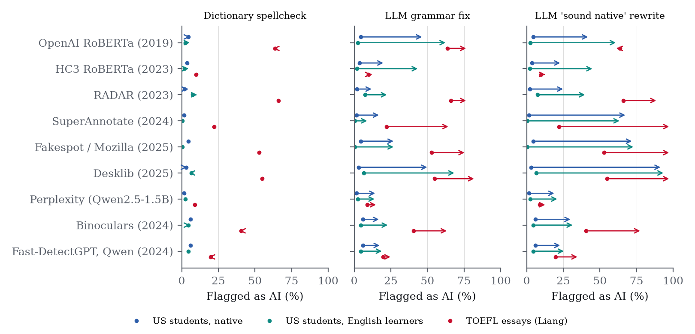

# Fixed by AI, Flagged as AI

[](https://doi.org/10.5281/zenodo.23400437)

**A matched audit of AI-text detectors on 12,132 student essays.**
[Zakhar Sukhanov](https://www.linkedin.com/in/zakhar-sukhanov-1ba2313b6/), 2026 · [Paper (PDF)](paper/paper.pdf) · [Results site](https://dek0rta.github.io/flagged/) · [LinkedIn](https://www.linkedin.com/in/zakhar-sukhanov-1ba2313b6/)

A widely cited 2023 study ([Liang et al.](https://arxiv.org/abs/2304.02819)) found that AI-text detectors flag most essays by non-native English writers as AI-generated. Its evidence compares 91 short TOEFL answers with essays by US students on other topics. This project asks the question again with essays in which English learners and native speakers answered **the same prompts**, and then edits the same human essays to see what actually triggers a false flag.



## Findings

With nine open detectors released between 2019 and 2025 (six trained classifiers, including the one behind Mozilla's Fakespot add-on, and three zero-shot methods):

- **The original result replicates on the original essays.** At default settings the trained classifiers flag 43–97% of Liang et al.'s TOEFL essays (mean 64%).
- **It does not hold on matched essays.** Holding prompt, grade and length fixed, 7 of 9 detectors flag English learners *significantly less* often than native-speaker peers, and none flags them more often.
- **An AI grammar fix gets human essays flagged.** When an LLM corrects only spelling and grammar, leaving most words in place, the share of English learners' essays flagged rises 3–57× across detectors (native speakers' essays 3–17×). A dictionary spellcheck barely changes anything.
- **The 2023 remedy now backfires.** Liang et al.'s "enhance the word choices to sound like a native speaker" rewrite, which reduced false positives in 2023, now raises them for every detector (6–149×).
- **The text matters, not the writer.** Short texts are flagged more, published model college-admission essays are flagged at up to 83%, and the effect of writing quality depends on the detector.

## Data

| Set | Essays | Source |
|---|---:|---|
| US students, native (PERSUADE 2.0) | 6,000 | [Crossley et al. 2024](https://github.com/scrosseye/persuade_corpus_2.0), CC BY-NC-SA 4.0 |
| US students, English learners (PERSUADE 2.0) | 2,244 | same |
| English learners with proficiency ratings (ELLIPSE) | 3,888 | [Crossley et al. 2023](https://github.com/scrosseye/ELLIPSE-Corpus), CC BY-NC-SA 4.0 |
| TOEFL essays and published college essays | 91 + 70 | [Liang et al. 2023](https://huggingface.co/datasets/WxWx/ChatGPT-Detector-Bias), MIT |
| AI essays on the same prompts | 2,989 | DAIGT v2 (Kaggle 2023, 15 LLM sources) |

The essays are not redistributed here; `scripts/download_data.sh` fetches them. Per-essay detector scores are in `results/scores*/`, keyed by the corpora's essay IDs.

## Reproduce

Requires macOS with Apple silicon (MLX and PyTorch MPS) or a CUDA machine for the detectors, and [uv](https://docs.astral.sh/uv/).

```bash
./scripts/download_data.sh                      # corpora into data/raw/
uv run python -m flagged.data                   # build data/processed/texts.parquet
uv run python scripts/prefetch_models.py        # detector and LLM weights
uv run python scripts/run_detectors.py          # score every essay with every detector
uv run python scripts/llm_rewrite.py grammar    # LLM grammar fix (Qwen2.5-7B-Instruct, MLX)
uv run python scripts/llm_rewrite.py native     # Liang et al.'s rewording
uv run python analysis/rewrites.py build        # edited essays, plus spellcheck and length controls
uv run python scripts/run_detectors.py --texts data/processed/rewrites.parquet --cache results/scores_rewrites
uv run python analysis/analyze.py && uv run python analysis/rewrites.py analyze
uv run python analysis/summarize.py && uv run python analysis/figures.py && uv run python analysis/site_data.py
uv run python paper/build.py                    # paper/paper.pdf
```

## Limitations

Open detectors only: Turnitin, GPTZero and Pangram are not tested. The English learners in PERSUADE are learning English in US schools, which is not the same as applying from abroad. The published college essays are polished examples, not a random sample. The zero-shot detectors use smaller language models than their original papers. The grammar fix was done by a local open model, as a stand-in for commercial writing tools.

## AI assistance

This project was carried out with the help of Claude (Anthropic), an AI assistant.

## Cite

```
Sukhanov, Z. (2026). Fixed by AI, flagged as AI: A matched audit of AI-text detectors
on 12,132 student essays. Preprint. https://doi.org/10.5281/zenodo.23400437
```

Code: MIT license.
